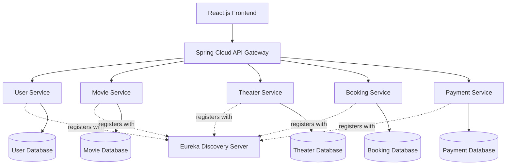

# SeatSync
### Movie Ticket Booking Platform | Microservices Architecture


SeatSync is a full-stack movie ticket booking platform being developed with Java, Spring Boot, React.js and MySQL. The project is designed around independently deployable microservices for user management, movies, theaters, bookings and payments.

The goal is to apply practical software engineering concepts including REST API development, authentication, service discovery, database management, frontend integration, automated testing and deployment.

> **Project status:** Under active development. This README distinguishes implemented work from planned functionality.

---

## Current Status

The **User Service** is the first service under development. The repository currently contains the User Service project; the remaining services and frontend are planned.

| Component | Responsibility | Status |
|---|---|---|
| User Service | Registration, login, authentication and user management | In progress |
| Movie Service | Movie catalogue, search and management | Planned |
| Theater Service | Theaters, screens, seats and showtimes | Planned |
| Booking Service | Seat selection, reservations and cancellations | Planned |
| Payment Service | Payment orders and verification | Planned |
| Eureka Server | Service registration and discovery | Planned |
| API Gateway | Central request routing | Planned |
| React Frontend | User interface | Planned |

## Implemented in User Service

- [x] Spring Boot project setup
- [x] User entity and repository
- [x] Registration request and response DTOs
- [x] User registration REST endpoint
- [x] BCrypt password hashing
- [x] Basic Spring Security configuration
- [ ] Login API
- [ ] JWT access-token generation and validation
- [ ] Refresh-token workflow
- [ ] JWT authentication filter
- [ ] Role-based authorization
- [ ] JUnit 5 and Mockito tests

## Target Architecture



*This is the target design, not a claim that all services are currently implemented or running.*

## Technology Stack

| Area | Technologies | Current use |
|---|---|---|
| Language | Java 21 | In use |
| Backend | Spring Boot, Spring MVC, REST APIs | In use |
| Persistence | Spring Data JPA, Hibernate | In use |
| Database | MySQL | In use |
| Security | Spring Security, BCrypt | In use |
| Token authentication | JWT (JJWT) | In progress |
| Microservices | Spring Cloud, Eureka, API Gateway | Planned |
| Frontend | React.js, JavaScript, HTML, CSS | Planned |
| Testing | JUnit 5, Mockito, Spring Boot Test | Planned |
| API testing | Postman | Used during development |
| Payments | Razorpay test mode | Planned |
| Build and version control | Maven, Git, GitHub | In use |
| Containerization and hosting | Docker, cloud hosting | Planned |

## API Documentation

### User Service

Local development URL: `http://localhost:8081`

#### Implemented endpoint

| Method | Endpoint | Description |
|---|---|---|
| POST | `/api/users/register` | Register a new user |

Example request:

```http
POST /api/users/register
Content-Type: application/json
```

```json
{
  "name": "Ravi",
  "email": "ravi@gmail.com",
  "password": "Ravi@12345"
}
```

Expected response: `201 Created`

```json
{
  "id": 1,
  "name": "Ravi",
  "email": "ravi@gmail.com"
}
```

The response should not expose the user's password. Login and refresh-token endpoints will be documented after they are implemented and tested.

## Planned Engineering Considerations

### Authentication

The intended authentication flow uses Spring Security for credential verification, BCrypt for password hashing, and signed JWT access and refresh tokens. Token validation, refresh-token rotation and revocation will be implemented and tested before being described as complete.

### Seat Reservation Concurrency

The Booking Service is planned to use database transactions and an appropriate concurrency-control strategy, such as JPA optimistic locking with `@Version`, to detect conflicting seat reservations. This behavior has not yet been implemented.

### Data Ownership

Each microservice is intended to own its data and database access. Services should communicate through APIs rather than directly querying another service's tables.

## Getting Started

### Prerequisites

- Java 21
- Maven
- MySQL Server
- Git
- Postman

### 1. Clone the repository

```bash
git clone https://github.com/kashboinasandeep/seatsync-microservices.git
cd seatsync-microservices
```

### 2. Create the User Service database

```sql
CREATE DATABASE cineticket_user_db;
```

### 3. Configure database credentials

Update the local datasource settings in:

`user-service/src/main/resources/application.properties`

Example:

```properties
spring.application.name=user-service
server.port=8081

spring.datasource.url=jdbc:mysql://localhost:3306/cineticket_user_db
spring.datasource.username=root
spring.datasource.password=YOUR_MYSQL_PASSWORD

spring.jpa.hibernate.ddl-auto=update
spring.jpa.show-sql=true
spring.jpa.properties.hibernate.format_sql=true
```

Use your own local credentials. Do not commit passwords, JWT secrets or other credentials to the repository.

### 4. Run the User Service

```bash
cd user-service
mvn spring-boot:run
```

### 5. Test registration

Send the registration request shown in the API Documentation section using Postman.

Setup instructions for other services will be added as those services are created.

## Development Roadmap

1. Complete User Service login, JWT authentication and refresh-token handling.
2. Add User Service unit and integration tests.
3. Build Eureka Discovery Server and API Gateway.
4. Develop Movie and Theater services.
5. Develop Booking Service and test concurrent seat reservations.
6. Integrate Razorpay in test mode through Payment Service.
7. Build the React frontend and integrate it with backend APIs.
8. Add end-to-end tests, Docker support and deployment documentation.

## Author

**Sandeep Kashaboina**  
Java Full Stack Developer

- GitHub: [kashboinasandeep](https://github.com/kashboinasandeep)

---

SeatSync is an ongoing portfolio and software development project. Features will be marked as complete only after implementation and appropriate testing.
