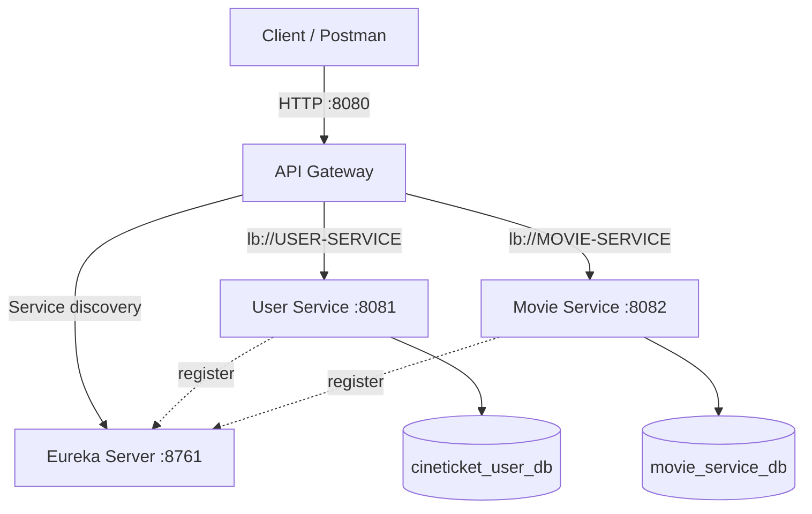

# SeatSync – Movie Ticket Booking Platform

SeatSync is a microservices-based movie ticket booking platform built using Java, Spring Boot, Spring Cloud and MySQL. The planned frontend is React.js. The platform is being developed as independently deployable services for users, movies, theaters, bookings and payments.

## Current implementation status

| Component | Responsibility | Status |
|---|---|---|
| User Service | Registration, login, JWT authentication and protected profile | Implemented and manually tested |
| Eureka Server | Service registration and discovery | Implemented; services registered locally |
| API Gateway | Central routing to backend services | Implemented; user, authentication and movie routes tested |
| Movie Service | Movie CRUD, validation, duplicate detection and exception handling | Implemented and manually tested |
| Theater Service | Theaters, screens, seats and showtimes | Planned |
| Booking Service | Seat selection, reservations and cancellations | Planned |
| Payment Service | Payment orders, verification and payment status | Planned |
| React Frontend | User interface and API integration | Planned |
| Automated tests | JUnit 5, Mockito and integration tests | Further automated coverage planned |

## Technology stack

| Area | Technologies |
|---|---|
| Language | Java 21 |
| Backend | Spring Boot, Spring MVC, REST APIs |
| Microservices | Spring Cloud, Netflix Eureka |
| API Gateway | Spring Cloud Gateway |
| Persistence | Spring Data JPA, Hibernate |
| Database | MySQL |
| Security | Spring Security, BCrypt, JWT (JJWT) |
| API testing | Postman |
| Automated testing | JUnit 5, Mockito, Spring Boot Test |
| Build and version control | Maven, Git, GitHub |
| Frontend | React.js, JavaScript, HTML, CSS (planned) |
| Payments | Razorpay test mode (planned) |
| Containerization and hosting | Docker and AWS (planned) |

## Architecture currently implemented

Eureka is used for service discovery. The API Gateway forwards incoming requests to registered service instances using load-balanced service names.

## Implemented services

### 1. User Service

**Port:** `8081`  
**Database:** `cineticket_user_db`

- User registration and login.
- BCrypt password hashing.
- Spring Security authentication.
- JWT access-token and refresh-token handling.
- JWT authentication filter.
- Protected user profile endpoint.
- Duplicate email handling.

### 2. Movie Service

**Port:** `8082`  
**Database:** `movie_service_db`  
**Gateway base path:** `/api/movies`

**Movie catalogue capabilities**
- Create a movie.
- Retrieve all movies.
- Retrieve a movie by ID.
- Update movie details.
- Delete a movie.
- Request DTO validation.
- Duplicate movie-title detection (case-insensitive check).

**Movie entity fields**
- ID, title, description, genre and language.
- Duration, release date and rating.
- Poster URL and creation timestamp.

**Movie Service API endpoints**

| Method | Endpoint | Description |
|---|---|---|
| POST | `/api/movies` | Create movie |
| GET | `/api/movies` | Retrieve all movies |
| GET | `/api/movies/{id}` | Retrieve movie by ID |
| PUT | `/api/movies/{id}` | Update movie |
| DELETE | `/api/movies/{id}` | Delete movie |

**Centralized exception handling**

| HTTP status | Exception / scenario | Meaning |
|---|---|---|
| 400 | `MethodArgumentNotValidException` | Request validation failed |
| 400 | `HttpMessageNotReadableException` | Invalid JSON or request body |
| 404 | `MovieNotFoundException` | Requested movie does not exist |
| 409 | `DuplicateMovieException` | Movie title already exists |
| 409 | `DataIntegrityViolationException` | Database constraint violation |
| 500 | Generic `Exception` handler | Unexpected server error |

Error responses include a timestamp, HTTP status, error name and message. Validation responses also include field-level details.

## Local application ports

| Application | Port |
|---|---:|
| Eureka Server | 8761 |
| API Gateway | 8080 |
| User Service | 8081 |
| Movie Service | 8082 |

## Running locally

Typical startup sequence:

1. Start MySQL.
2. Start Eureka Server on port `8761`.
3. Start User Service on port `8081`.
4. Start Movie Service on port `8082`.
5. Start API Gateway on port `8080`.
6. Open `http://localhost:8761/` and verify service registration.
7. Test APIs through Postman using `http://localhost:8080`.

Configure database credentials and JWT signing secrets using environment variables or an untracked local configuration file. Never commit passwords, signing secrets or tokens to GitHub. Rotate any credential that has previously been committed.

## Planned development roadmap

1. Develop Theater Service for theaters, screens, seats and showtimes.
2. Develop Booking Service with safe seat reservation and concurrency handling.
3. Develop Payment Service and integrate Razorpay in test mode.
4. Build the React frontend and integrate it with the API Gateway.
5. Expand automated unit and integration test coverage.
6. Add Docker support and deployment documentation.
7. Deploy the services to AWS.

## Data ownership and booking safety

Each microservice is intended to own its database/schema. Services should communicate through APIs or messaging rather than directly querying another service's tables. Transactional seat reservation and concurrency protection are planned for Booking Service and are not yet implemented.

## Git workflow

The project uses a feature-branch workflow:

- `main` – stable integration branch.
- `feature/user-service` – User Service development.
- `feature/movie-service` – Movie Service development.
- Future services will use their own feature branches.

Changes are committed to feature branches, pushed to GitHub and merged into `main` through Pull Requests.

## Author

**Sandeep Kashaboina**  
Java Full Stack Developer

- GitHub: [kashboinasandeep](https://github.com/kashboinasandeep)

---

SeatSync is an ongoing portfolio project. The implementation status above describes the current project scope; planned components are not yet available.
