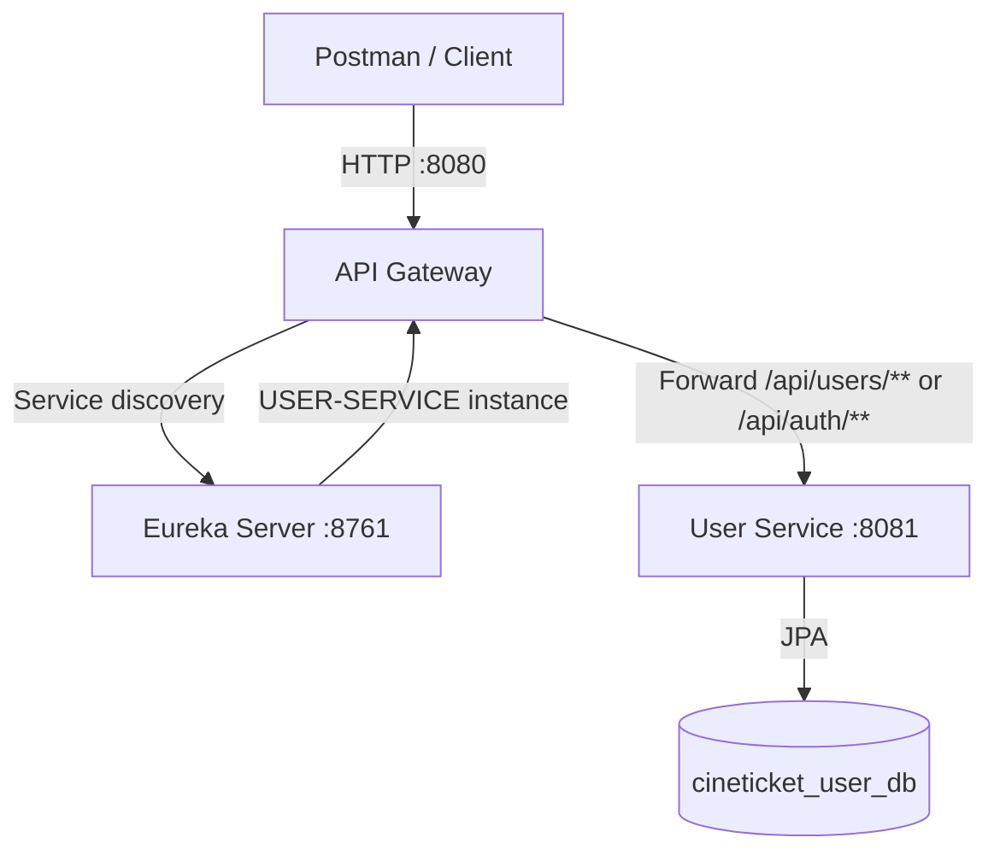
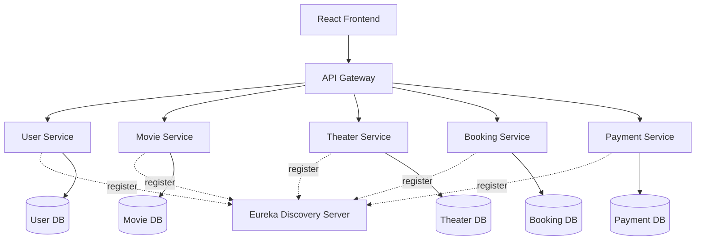

# SeatSync
### Movie Ticket Booking Platform | Microservices Architecture

SeatSync is a movie ticket booking platform being developed with Java 21, Spring Boot, Spring Cloud, React.js and MySQL. The target architecture uses independently deployable services for users, movies, theaters, bookings and payments.

> **Progress note (14 November 2026):** User Service, Eureka Server and API Gateway have been implemented in the local development environment and the end-to-end Gateway routes for registration, login and a JWT-protected profile request have been manually tested with Postman. The Eureka Server dashboard showed both USER-SERVICE and API-GATEWAY as UP. Check the repository branch before assuming every locally tested application has already been committed and pushed.

---

## Current implementation status

| Component | Responsibility | Status |
|---|---|---|
| User Service | Registration, login, JWT access/refresh tokens, protected profile | Implemented and manually tested locally |
| Eureka Server | Service registration and discovery | Running locally; User Service and API Gateway registered |
| API Gateway | Central HTTP routing to backend services | Running locally; user and auth routes tested |
| Movie Service | Movie catalogue, search and management | Next planned service; not started/confirmed |
| Theater Service | Theaters, screens, seats and showtimes | Planned |
| Booking Service | Seat selection, reservations and cancellations | Planned |
| Payment Service | Payment orders, verification and payment status | Planned |
| React Frontend | User interface and API integration | Planned |
| Automated test suite | JUnit 5, Mockito and integration tests | Further automated coverage pending |

## Verified local API flow

The following requests were sent through API Gateway on port 8080 using Postman:

| Operation | Request | Result |
|---|---|---|
| Register | `POST /api/users/register` | `201 Created` |
| Login | `POST /api/auth/login` | `200 OK` |
| Protected profile | Existing profile GET endpoint with a Bearer access token | `200 OK` |

### Local application ports

| Application | Port | Eureka application name |
|---|---:|---|
| Eureka Server | 8761 | Registry server |
| API Gateway | 8080 | `api-gateway` |
| User Service | 8081 | `user-service` |

### Request routing

Eureka is the registry used for service discovery. The Gateway route IDs (for example, `auth-route`) are developer-chosen labels; both current routes target `lb://USER-SERVICE`.

## User Service capabilities

- User entity and Spring Data JPA repository
- Registration request and response DTOs
- Input validation for registration data
- BCrypt password hashing
- Duplicate-email handling
- Login using Spring Security's AuthenticationManager and DaoAuthenticationProvider
- JWT access-token and refresh-token generation
- JWT authentication filter for protected requests
- Protected profile endpoint
- Refresh-token endpoint
- Manual negative-path checks reported for missing, invalid and expired tokens, duplicate email and incorrect password

**Security reminder:** Never commit database passwords, JWT signing secrets, access tokens or refresh tokens. Keep local secrets in environment variables or an untracked local configuration file. If a credential was ever committed, rotate it; deleting it from the latest file does not invalidate the exposed credential.

## Technology stack

| Area | Technologies | Status |
|---|---|---|
| Language | Java 21 | In use |
| Backend | Spring Boot, Spring MVC, REST APIs | In use |
| Persistence | Spring Data JPA, Hibernate | In use |
| Database | MySQL | In use for User Service |
| Security | Spring Security, BCrypt, JWT (JJWT) | Implemented in User Service; manually tested |
| Service discovery | Spring Cloud Netflix Eureka | Running locally |
| API routing | Spring Cloud Gateway WebFlux | Running locally |
| Load balancing | Spring Cloud LoadBalancer | Used by `lb://USER-SERVICE` routing |
| Frontend | React.js, JavaScript, HTML, CSS | Planned |
| Automated testing | JUnit 5, Mockito, Spring Boot Test | More coverage planned |
| API testing | Postman | Used for manual endpoint verification |
| Payments | Razorpay test mode | Planned |
| Build and version control | Maven, Git, GitHub | In use |
| Containerization and hosting | Docker, cloud hosting | Planned |

## Target microservices architecture

The following is the intended end-state architecture. Only the User Service, Eureka Server and API Gateway have been confirmed implemented at this stage.

## Planned next steps

1. Create Movie Service as a separate Spring Boot application (planned port 8082).
2. Configure its own MySQL database and Eureka client registration.
3. Add a Gateway route for `/api/movies/**` after Movie Service is running.
4. Build Theater Service for theaters, screens, seats and showtimes.
5. Build Booking Service and implement transactional seat reservation with concurrency protection.
6. Build Payment Service and integrate Razorpay in test mode.
7. Build the React frontend and connect it to Gateway APIs.
8. Add automated tests, Docker support and deployment documentation.

## Data ownership and booking safety

Each microservice is intended to own its database/schema. Services should use APIs or messaging to communicate rather than directly querying another service's tables. Booking concurrency controls (for example, transactions and JPA optimistic locking with `@Version`) are planned and are **not yet implemented**.

## Local development notes

Typical local startup order:

1. Start MySQL.
2. Start Eureka Server on port 8761.
3. Start User Service on port 8081.
4. Start API Gateway on port 8080.
5. Open `http://localhost:8761/` and confirm the expected applications are UP.
6. Run the Postman requests through `http://localhost:8080`.

Use local environment variables for database and JWT secrets. Do not paste credentials into source files or commit them to Git.

## Author

**Sandeep Kashaboina**  
Java Full Stack Developer

- GitHub: [kashboinasandeep](https://github.com/kashboinasandeep)

---

SeatSync is an ongoing portfolio project. Status labels distinguish locally verified functionality from future work and from code that has been committed to the repository.
